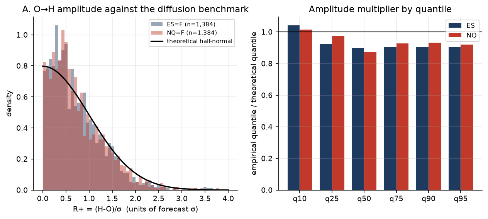
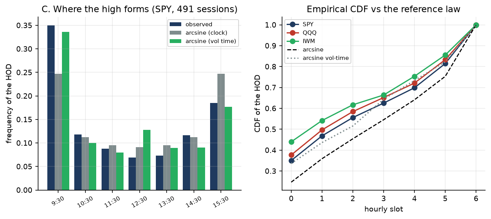
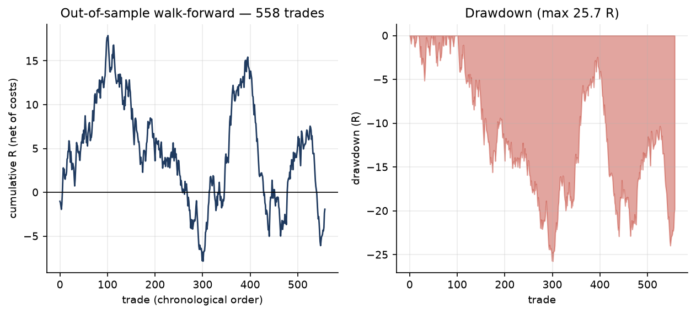

# Trading-Desk

Quantitative intraday research on **ES** (S&P 500 futures) and **NQ** (Nasdaq 100 futures).

---

## Where the HOD and the LOD form — statistical study and backtest

> **Verdict in one line:** the statistics hold; the trading edge does not. Net expectancy
> **−0.0035 R** per trade over 558 out-of-sample trades, DSR **0.008**, permutation
> p = 0.54, bootstrap CI **[−51.3, +41.6] R**. On ES the net is already negative at two
> ticks (−0.0074 R) and worse at three (−0.0229 R). The probability model is informative;
> the stop-and-target structure built on top of it is not profitable.

📄 **[Read the full report (PDF, 11 pages)](research/out/HOD_LOD_ES_NQ.pdf)**

The high-of-day (HOD) and the low-of-day (LOD) are not levels, they are **argmax
times**. This repository treats the four sub-problems separately — amplitude,
localization, timing, real-time probability — then aggregates them into a strategy
and tests it honestly.



### The numbers that matter

| Question | Theory | Measured | Reading |
|---|---|---|---|
| Amplitude `E[range]/σ` | 1.596 | **1.820** | the market travels 14% more than diffusion |
| Amplitude multiplier q25→q95 | 1.00 | **1.06–1.12** | a single constant `κ ≈ 1.09` fixes it |
| `P(amplitude in [q25,q75])` | 50% | **50.3%** | calibrated |
| Arcsine law (clock) | — | **rejected** (χ² 34–109) | the market concentrates more at the open |
| Arcsine law (vol time) | — | KS ÷ 2.6, **still rejected** | better, but not enough |
| `P(running HOD = final)` | — | **BSS +0.33 to +0.39** | the formula genuinely predicts |
| Walk-forward backtest | — | **−0.0035 R net** | negative, not significant |



The question "how often does the market do what we compute" has its own section in
the PDF. Excerpt, over the 370 usable sessions (σ available):

| Is the HOD already final at… | Predicted | Observed |
|---|---|---|
| 10:30 | 34.7% | **35.1%** |
| 12:30 | 49.1% | **56.5%** |
| 15:30 | 76.9% | **81.8%** |

The gap is systematically negative: the model is **slightly under-confident**,
exactly the direction predicted by the discrete-monitoring bias.



### What the test does not say

- **Granularity.** The free source caps intraday history at **730 days** (5/15/30 min:
  60 days only). The backtest is therefore hourly. A minute-level trigger would have a
  very different entry timing: this is the main limitation.
- **Instruments.** The backtest runs on SPY/QQQ/IWM (proxies whose OHLC is validated to
  within 2 bp), not on futures. The costs applied are those of ES.
- **No result is adjusted in favour of the strategy.** The ledger of the 90 tested
  configurations is in `research/out/results.json`.
- **One trade per instrument per day.** Allowing duplicate entries on the same side
  inflated the sample (1,190 trades); deduplicating is the honest convention, because one
  directional bet is one observation.
- **The sign of the net result is fragile.** Fixing the sigma-to-points look-ahead,
  capping entries at one per day and restoring the HAR smearing correction moved the net
  between +0.019 R and −0.004 R without any change of strategy. That instability is
  itself the result: a real edge does not change sign when a constant factor moves.
- **Skill against the right benchmark.** Calibration beats the *raw diffusion formula*
  only after the first hour (BSS −0.03 to −0.08 at 10:00, up to +0.17 at 12:30). Beating
  climatology by +0.33 was never the relevant test.

### Structure

```
hodlod/            Theory library (no dependency on the data)
├── vol.py           Parkinson, Garman-Klass, Rogers-Satchell, Yang-Zhang,
│                    seasonal profile, HAR-RV, CARR(1,1) quasi-ML
├── amplitude.py     half-normal benchmark, GPD/POT, quantile regression, boosting
├── timing.py        arcsine laws, volatility time, PIT, competing risks
├── realtime.py      survival probability, two-sided barriers, calibration
├── levels.py        confluence levels + matched-distance placebo
├── evaluate.py      purged walk-forward, Brier, CRPS, DSR, block bootstrap
└── selftest.py      21 Monte-Carlo checks of the closed forms

research/          Empirical pipeline (downloads public data)
├── data.py          Yahoo Finance + validation of the hourly reconstruction
├── engine.py        study + walk-forward backtest + Monte-Carlo
├── report.py        PDF generation
└── out/             PDF, figures, results, trade blotter

report/
└── HOD_LOD_report.md    Theory report: models, equations, assumptions, limits
```

### Reproduce

```bash
python3 -m venv --system-site-packages .venv
.venv/bin/pip install -r requirements.txt

.venv/bin/python -m hodlod.selftest      # 21 Monte-Carlo self-tests
.venv/bin/python -m research.data        # download and validate the data
.venv/bin/python -m research.engine      # study + backtest + Monte-Carlo
.venv/bin/python -m research.report      # regenerate the PDF
```

Raw data are not versioned (they are regenerable, and redistributing them is not our
business): `research.data` re-downloads them and caches them in `research/cache/`. The
**results** are versioned in `research/out/` — a clone is enough to read the PDF without
running anything.

### Method

No information leakage: `σ` is a HAR on an expanding window re-estimated every 20 days,
using only variances ≤ J−1; the backtest enters at the open of the bar following the
signal; the threshold and the take-profit are chosen by monthly walk-forward on past
data only. Overfitting controls: trial ledger, deflated Sharpe, permutation test, block
bootstrap, sign consistency across instruments.
